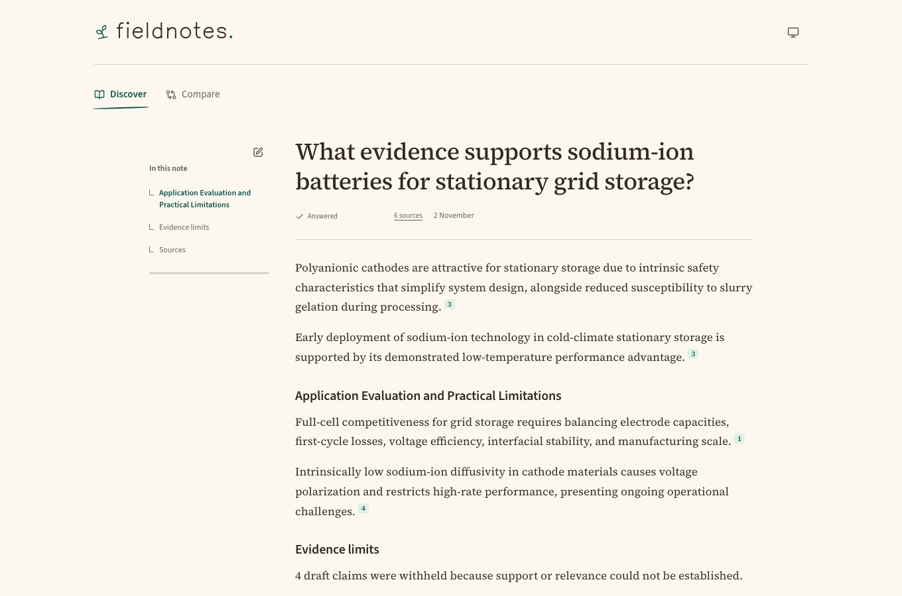
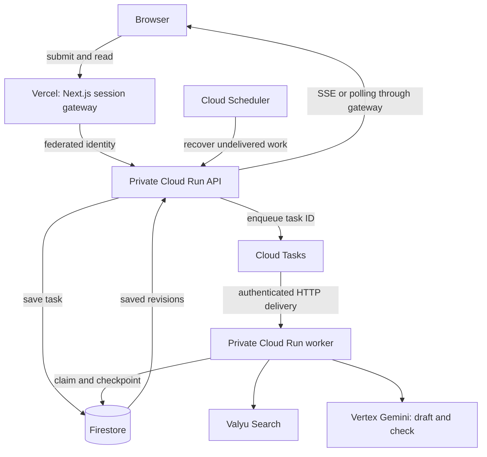

# Fieldnotes

A scientific research app that finds sources, drafts claims tied to specific passages, and shows what the evidence does—and does not—answer. **Discover** explores one question; **Compare** examines two alternatives without forcing a winner.

Built as a full-stack take-home with a Google Cloud backend and Vercel frontend. **The hosted research demo is retired.** The app runs locally with labelled synthetic providers, without research keys or a Google login. See the [retirement record](docs/retirement.md).



## See the result

**[Watch the 57-second demo](examples/demo/fieldnotes-local-demo.mp4)** — a real local synthetic task: submit a question, watch saved sections arrive, inspect a citation and source passage, then refresh the saved report. The recording is silent and labelled throughout. It demonstrates the application workflow, not live retrieval or model evidence checking.

- **[Discover report](examples/discover.md):** a saved research answer with source links. Also available as a [PDF](examples/discover.pdf).
- **[Compare report](examples/compare.md):** an honest “not directly answered” result, with related evidence and unresolved questions. Also available as a [PDF](examples/compare.pdf).
- **[Evidence and before/after examples](examples/README.md):** actual outputs, observed timings and the limits of the checks.
- **[Interactive project guide](https://fieldnotes-interview-pocket-owen.milkandhenny.chatgpt.site):** request lifecycle, recovery, architecture trade-offs and evidence checks. The [standalone HTML](docs/interview-guide/index.html) also opens directly in a browser.

The intended user is a researcher making an initial scan of an unfamiliar question. Source cards expose metadata and the retained passage behind a claim. The search trail exposes the queries, so a retrieval gap can be distinguished from a gap in the literature.

## Three engineering decisions

| Decision                           | Result                                                                                                                      | Trade-off                                                                                              |
| ---------------------------------- | --------------------------------------------------------------------------------------------------------------------------- | ------------------------------------------------------------------------------------------------------ |
| **Durable asynchronous execution** | Save a task before returning its ID. Queue delivery, leases, epochs and checkpoints protect ownership and reuse saved work. | External paid calls can still have uncertain outcomes; exactly-once provider execution is not claimed. |
| **Claim-to-passage grounding**     | Code owns citation links and passage text. A separate model call checks support and question coverage before publication.   | Additional latency and cost; a model check does not establish scientific truth.                        |
| **One provider-cost ledger**       | Reserve allowance before calls, settle from receipts, retain uncertain reservations.                                        | Spending control is implemented; complete measured per-task accounting remains unfinished.             |

## Run locally

Requires **Node 26+, pnpm 12 and Docker**.

```sh
pnpm install --frozen-lockfile
pnpm dev
```

Open the browser URL printed by the supervisor. Local mode uses synthetic research providers with the real API, worker and Firestore emulator. It exercises the workflow without paid research calls; it does not reproduce real provider quality or latency.

In a second terminal:

```sh
pnpm verify
node scenarios/local-reliability.ts
```

The second command exercises reliability against the running local services. [Operations](docs/operations.md) covers API examples, local persistence, diagnostics and the historical deployment setup.

## Architecture

The retired deployment used private Cloud Run services, Firestore, Cloud Tasks, Cloud Scheduler, Secret Manager and Vertex Gemini. Vercel served Next.js and its session gateway. Valyu Search, through the official SDK, supplied source material; DeepResearch and Answer were not used.



Google Cloud and Vercel were assignment requirements. This particular managed-service design was a choice: it reduced host operations for a small, bursty workload. A VM and Postgres could implement the same workflow. The trade-offs include platform coupling, cold starts and document/read-write constraints.

| Code                 | Responsibility                                    |
| -------------------- | ------------------------------------------------- |
| `apps/web`           | Report reader, navigation and session gateway     |
| `apps/api`           | Acceptance, ownership checks and saved snapshots  |
| `apps/worker`        | Queue delivery and worker composition             |
| `packages/research`  | Workflow, provider ledger and grounding rules     |
| `packages/adapters`  | Firestore, Valyu, Vertex and synthetic providers  |
| `packages/contracts` | Runtime schemas, limits, typed errors and OpenAPI |

## Limits and next steps

- **Complete cost accounting is unfinished.** Search deductions are measured; model charges are estimated from tokens. Shared infrastructure is not allocated to tasks or reconciled against invoices.
- **Retrieval is bounded.** Two or three templated searches can find related papers without answering the exact question. Follow-up search, reranking and contradiction checks remain proposals.
- **Evidence checks are fallible.** The writer, coverage plan and checker use model judgement. Ten reviewed evaluation cases are a regression gate, not an independent scientific benchmark.
- **Scale and recovery need more evidence.** No production capacity claim is made. Larger load tests, restore testing and retention/deletion policies remain work to do.

Next priorities: finish accounting, improve useful-answer retrieval, and strengthen quality and operational evidence. The brief allowed at most one implemented orchestration improvement; the selected technique was claim-to-passage grounding.

## Technical detail

<details>
<summary>Execution, recovery and live updates</summary>

The worker's guarantees reduce to three rules, each owned in one place.

1. **Every step saves its output before the next starts, and redelivery skips finished steps.** A task runs as retrieve, write and finalize. Retrieve saves the merged sources. Write saves the finished draft lines inside the model's ledger operation, each passage-check result as it returns, and the key of every published block; a redelivered task replays the saved draft without another model call, reuses saved checks and never duplicates a block. A draft interrupted mid-stream stays visible and fails rather than paying for a second generation.
2. **Every provider call goes through one ledger** ([ledger.ts](packages/research/src/ledger.ts)): reserve the allowance before the request, call, settle from the provider's receipt. An uncertain call keeps its full reservation.
3. **Every write carries the lease epoch**, so a stale worker cannot overwrite a newer one.

Retries belong to the queue. A rejection the provider confirms cost nothing (Google 429/503 before a stream opens, or a Valyu rate limit with a measured zero deduction) hands the task back to Cloud Tasks, which redelivers with 10–60s backoff; the step runner resumes. Uncertain charges, non-retryable errors, the five-minute deadline and the third attempt fail visibly, with sources and any draft retained.

| State               | Meaning                                                         |
| ------------------- | --------------------------------------------------------------- |
| queued              | Accepted; waiting for a worker                                  |
| running / searching | Gathering source material                                       |
| running / writing   | Publishing checked sections as they pass                        |
| running / checking  | Validating the assembled report                                 |
| succeeded           | Final report with `outcome`: answered, partial or unanswered    |
| failed              | Work stopped; `outcome: failed`; sources and any draft retained |

The browser shows server truth. Streaming fits this product because a report arrives as checked sections over 10–40 seconds: SSE pushes each saved revision as it lands without a polling delay, needs only one-way traffic, and works through the Vercel proxy. Polling remains the fallback because streams stall or close on mobile networks, proxies and sleeping tabs. Each SSE stream starts from the latest saved snapshot and revisions only move forwards; polling serves the same snapshot as a fallback, with jittered backoff and pauses in hidden or offline tabs. REST/JSON with a generated OpenAPI contract (`/openapi.json`) keeps the boundary inspectable; `schemaVersion: 1` is unchanged by additive fields such as `outcome`.

| Capability                                    | Owner                |
| --------------------------------------------- | -------------------- |
| HTTP, ownership, durable acceptance, SSE      | `apps/api`           |
| Queue delivery and worker composition         | `apps/worker`        |
| Reading, navigation, session gateway          | `apps/web`           |
| Schemas, limits, typed errors, OpenAPI        | `packages/contracts` |
| Steps, ledger, grounding                      | `packages/research`  |
| Firestore, Valyu, Vertex, synthetic providers | `packages/adapters`  |

</details>

<details>
<summary>Retrieval, grounding and evaluation</summary>

Discover makes one unrestricted primary search and one academic search for limitations and conflicting evidence. Compare makes one academic search per named alternative and one unrestricted comparison search. These are deterministic templates, run concurrently, not a planning-model call. Search uses `searchType: all`, three results per query, medium content and abstracts. Academic searches query exactly the five scholarly collections (arXiv, PubMed, bioRxiv, medRxiv, ChemRxiv) whose records can become findings. A live Compare limited to PubMed and arXiv found no lithium iron phosphate records at all; the wider set returned two or three papers per alternative at about USD0.0055 per search.

Sources keep the structured metadata Valyu returns (authors, dates, type, DOI and citation where present), query provenance and a bounded excerpt. Long documents keep question-focused windows rather than only their opening, with original offsets recorded and an omission marker that no passage may cross.

**The one implemented orchestration technique is claim-to-passage grounding.** Code builds a passage catalogue; the model writes each atomic claim and selects a source and passage ID; code attaches the passage and citation link. A separate, budgeted model call then checks every claim against its passage before it can appear. Partial, contradictory and insufficient support is withheld, and the same check records which planned parts of the question each claim actually answers. Scientific Compare and evidence answers may cite only research records (provider-classified papers, the scholarly collections above, or a DOI link); ordinary web pages stay visible in Sources but cannot become findings.

Before and after, from a real output: an earlier Compare paragraph cited general lithium-ion operating guidance for a sentence that also reported an LFP cooling experiment. A URL-only check accepted it, because the citation link was valid. With grounding, the checker marks that claim partial and it is withheld; the plain guidance claim from the same passage passes. Both are cases in the offline evaluation gate below, alongside a supplier figure presented as "proven", an overreach to another chemistry, an absence claim and a table value attributed to the neighbouring row. The full before/after outputs are in [examples](examples/README.md).

When checked claims exist but none answers the question, the result opens with a server-written "Not directly answered" statement and shows them only as related evidence. This is the current Compare example: the retrieved papers report sodium-ion cathode cycling but no comparison with LFP under grid conditions.

Changes to the checker or synthesis prompt, model or thinking settings are gated by an offline evaluation: ten reviewed claim-and-passage cases run through the real checker (`node scripts/evaluate-claims.ts --run`, under USD0.05). All ten passed on 2 November; a deliberately lax checker failed two. A coding agent selected and labelled the cases; they are not an independent scientific benchmark.

Further techniques remain proposals to evaluate against that set before adding: an adaptive follow-up search when a required part stays unanswered, source reranking and contradiction checks. The brief asks for at most one implemented technique, and a follow-up search would also need a second generation within the 12-operation limit.

</details>

<details>
<summary>Configured limits, historical costs and timings</summary>

| Limit                   | Current envelope                                                                                      |
| ----------------------- | ----------------------------------------------------------------------------------------------------- |
| Question / alternatives | 500 characters; two alternatives of 120 characters                                                    |
| Searches / sources      | At most three searches and eight sources                                                              |
| Task provider allowance | USD0.10, reserved before each operation; at most 12 operations                                        |
| Search                  | USD0.01 per request                                                                                   |
| Generation              | USD0.06; 48,000 input bytes; 3,500 output tokens                                                      |
| Passage check           | At most USD0.012; 768 output tokens (thinking counts against it)                                      |
| Lifetime demo allowance | USD1.50, USD0.10 per accepted task, unused allocation released by the reconcile tool                  |
| Admission               | Three active tasks; 100 per day                                                                       |
| Runtime                 | Five-minute task deadline; worker run at most three minutes; 60-second lease renewed every 15 seconds |
| Queue / compute         | One concurrent delivery; three attempts; one instance per service, zero minimum                       |

Per-task provider cost on the current examples: Discover USD0.0075 measured Search and USD0.0132 estimated model; Compare USD0.0128 and USD0.0121. Search deductions are measured per Valyu transaction. Model cost is estimated from reported tokens at the verified EU rates (USD0.825 per million input, USD4.125 per million output, through 31 December 2026; the adapter fails closed after that date). Model use (generation plus checks) exceeds retrieval for Discover, while Compare's three searches cost about as much as its model use; each passage check adds about USD0.001–0.002. Cloud Run, Firestore, Cloud Tasks, Scheduler, logs, traces and Vercel Hobby are shared costs with no per-task allocation, and no free credit is assumed. The retired deployment used a GBP1 project budget warning and a GBP5 new-spend ceiling.

**Per-task COGS is therefore partial.** The planned final step is nightly reconciliation against the Cloud Billing export to BigQuery: label each Vertex request with its task reference so model charges join exactly, replace token estimates with invoiced amounts, allocate Cloud Run, Firestore and Cloud Tasks charges by each task's recorded run time, writes and deliveries, and report the unallocated remainder separately. This is documented, not implemented.

Latency is variable and its bottleneck moves: the current Discover example (30.5s) waited 8.0s on one search and Compare (21.5s) 12.5s on another, while earlier runs were dominated by the model, and Gemini took up to 66 seconds to open a stream during one evening's degradation, which hit the 90-second write deadline. These are observed runs, not percentiles. [latency-profile.json](examples/latency-profile.json) records the measured samples.

</details>

<details>
<summary>Scaling to 10× and 100×</summary>

Use a measured baseline before multiplying it. At one task per minute and a 30-second worker run, about 0.5 tasks run at once; ten times that is about five, a hundred times about fifty. Those are planning examples, not measured capacity. Viewer load is separate: one stream per open tab can exceed worker concurrency by far.

| Pressure                  | 10x                                                                                | 100x                                                                                                            |
| ------------------------- | ---------------------------------------------------------------------------------- | --------------------------------------------------------------------------------------------------------------- |
| Provider quotas and spend | Measure latency, 429s, deductions and tokens; raise queue rate only within budget  | Global quota and budget admission, per-tenant fairness, provider capacity agreements                            |
| Workers and queue age     | Raise Cloud Tasks concurrency and Cloud Run limits from measured run time          | Separate long and short work when queue age and step variance justify it; the step checkpoints already allow it |
| Database contention       | Profile the global admission and wallet transactions and writes per section        | Replace hot global counters with allocated admission; move large artifacts to object storage                    |
| Browser connections       | Measure active viewers, snapshot size, listener reads and reconnect storms         | Shared change fan-out and bounded stream gateways instead of one listener per browser                           |
| Polling and caches        | Conditional GET saves bytes, not the read that finds the revision                  | Cache immutable authorised artifacts by owner, task and revision                                                |
| Operations                | Alerts on queue age, errors and unknown reservations; per-step spans already exist | Tested backup and restore, retention and regional recovery; leases are not disaster recovery                    |

What breaks first is provider latency and the single worker instance: one slow model stream occupies the only delivery slot. Measure queue age, time to first checked section, provider errors, unknown reservations and cost per useful result before scaling anything. Load testing is planned with synthetic providers (k6 for admission, viewers and reconnects) and has not been run.

</details>

<details>
<summary>Additional limitations</summary>

- Per-task COGS is partial, as above.
- Retrieval is two or three templated searches, not a literature review. A question whose retrieved records only partly answer it gets a partial result; supported but off-question findings give a labelled unanswered result; and when no checked claim survives, or a Compare retrieves no research records, the task fails visibly with its sources retained.
- The checker and the coverage plan are model judgements. They catch the evaluated failure kinds but prove neither completeness nor scientific truth.
- Whether an answer is an explanation or an evidence assessment is decided by the model's plan, so a scientific Discover question framed as an explanation can still cite attributed web accounts.
- Sessions are anonymous 24-hour demo sessions without recovery or deletion; reports are not deleted automatically.
- Provider outages surface as visible failures: Valyu's academic search was unavailable for about 15 minutes and Gemini was slow for part of 2 November.

</details>

<details>
<summary>Interface design</summary>

The app owns the adapted Looseleaf paper components and its MIT notice. Source Sans 3 is the interface face, Source Serif 4 the reading face, Kevin Sans only for accents. Appearance cycles System, Light and Dark with separately designed palettes whose selected contrast pairs were measured. Keyboard focus, Escape, mobile sheets and browser history are part of the interaction checks. Markdown download and print share the final report. The interface prioritises readable reports, explicit state and inspectable evidence.

</details>

## Evidence, data and licence

Saved outputs and release observations date from the interview deployment; they are historical evidence, not a live-service claim. See the [release record](examples/release.json) and [retirement record](docs/retirement.md).

The public edition excludes employer correspondence, the original brief, private review notes, credentials and the full Firestore archive. Long retrieved excerpts are omitted from public example JSON. The reader scenario uses an explicitly synthetic extraction fixture. The original private records remain local.

Development used coding agents and separate read-only Codex reviews. Earlier Codex-built changes received same-provider review; later orchestration work was built with Claude at the author’s direction and reviewed by Codex. These reviews do not constitute independent scientific validation.

Original contributions retain the [recruitment-evaluation licence](LICENSE); public visibility does not grant an open-source licence. Adapted Looseleaf components retain their separate MIT notice.
